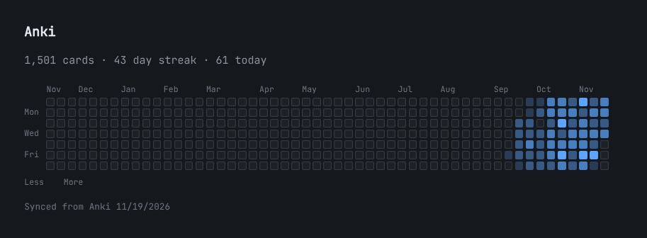
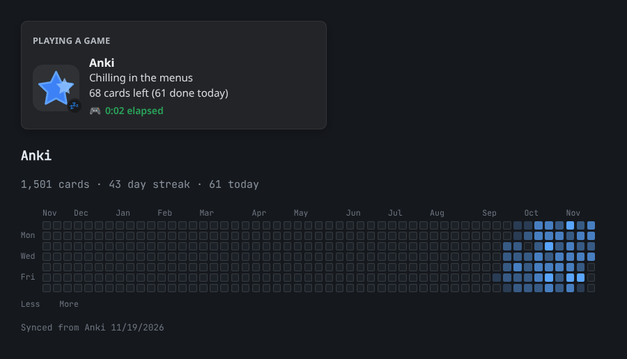

# Anki Tracker Push

Pushes your Anki review activity to a tracker API in real time, so your portfolio site can show a live Discord-style presence card and a GitHub-style review heatmap without manual exports.

Forked from [Monacraft/AnkiDiscord](https://github.com/Monacraft/AnkiDiscord). Discord RPC (`pypresence`) was removed; updates are now plain HTTP POSTs.

## Quick start

```sh
# 1. Install into Anki
cp -r . ~/.local/share/Anki2/addons21/anki-tracker-push

# 2. Restart Anki, then open config
#    Tools -> Add-ons -> Anki Tracker Push -> Config

# 3. Set your endpoint and token
{
  "apiUrl": "https://your-domain.com/api/anki",
  "token": "your-shared-secret",
  "minSecondsBetweenPushes": 15
}
```

Review a card. The push fires within `minSecondsBetweenPushes` seconds.

## Features

| Feature | What it does |
|---|---|
| Live presence | Reports app state (reviewing, browsing, editing, menus), cards left, cards done today, session start time |
| Accurate counts | Reads the root deck node to avoid double-counting nested decks |
| Real-time push | Fires on card answers, state changes, syncs, and a 15 s heartbeat |
| Heatmap history | Buckets reviews across 371 days using Anki's `day_cutoff` rollover |
| Streak logic | Counts consecutive active days; today at 0 does not break the streak |
| Card inventory | Sends total cards in the collection alongside review history |

## What it sends

### Live update

```json
{
  "v": 1,
  "days": [["2026-11-18", 56], ["2026-11-17", 33]],
  "today": 56,
  "totalReviews": 3121,
  "totalCards": 1501,
  "currentStreak": 43,
  "updatedAt": "2026-11-18T18:58:36Z",
  "presence": {
    "status": "online",
    "state": "Daily reviews",
    "details": "68 cards left (56 done today)",
    "startedAt": 1795027639,
    "icon": "tick-dark"
  }
}
```

### Shutdown ping

When Anki closes, a lightweight offline signal is sent so the web card flips to offline immediately. Stored review history is not touched.

```json
{
  "v": 1,
  "presence": { "status": "offline" }
}
```

## Persistence: Upstash Redis (optional)

The tracker API runs in one of two modes:

| Mode | Data survives Anki close? | Setup |
|---|---|---|
| In-memory | No | Nothing |
| Upstash Redis | Yes | Set env vars on the server |

Without Redis, the API keeps stats in process memory. When Anki closes and the serverless function scales down, the data is gone. Your site shows a "Waiting for Anki sync" state until you open Anki again.

With Redis, the last known state persists, so your portfolio shows the heatmap and streak even while Anki is closed.

### Configure Redis on the server

Set these on your host (example for Vercel):

```sh
vercel env add UPSTASH_REDIS_REST_URL production
vercel env add UPSTASH_REDIS_REST_TOKEN production
vercel env add ANKI_TRACKER_TOKEN production
```

Or add them to `.env` locally:

```env
UPSTASH_REDIS_REST_URL=https://your-instance.upstash.io
UPSTASH_REDIS_REST_TOKEN=your-upstash-token
ANKI_TRACKER_TOKEN=your-shared-secret
```

The API falls back to in-memory mode when the Redis vars are absent, so you can run it with no database if you only need live data while Anki is open.

## Example output

### Anki closed, stats served from Redis



### Anki open, live Discord presence card



## Testing

```sh
python3 tests/test_stats.py
```

Covers bucket boundaries, the 371-day window, empty buckets, and the streak rule (today still empty does not reset yesterday's streak).
